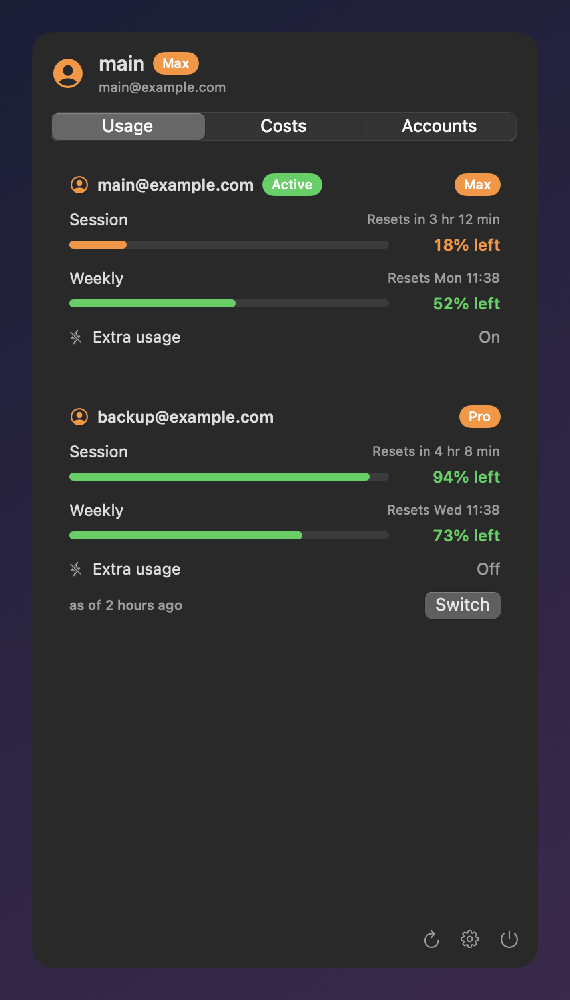
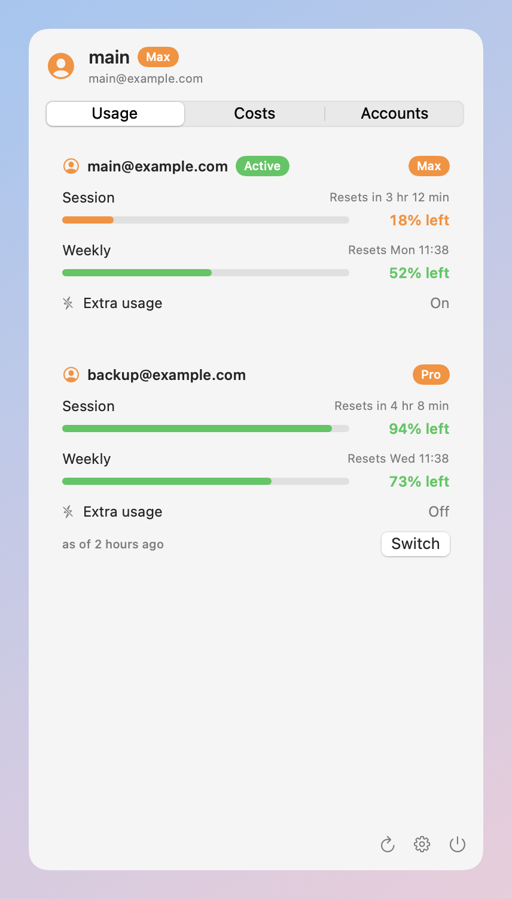
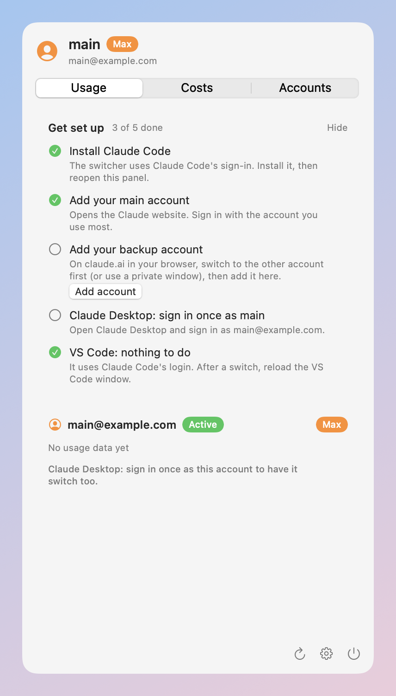
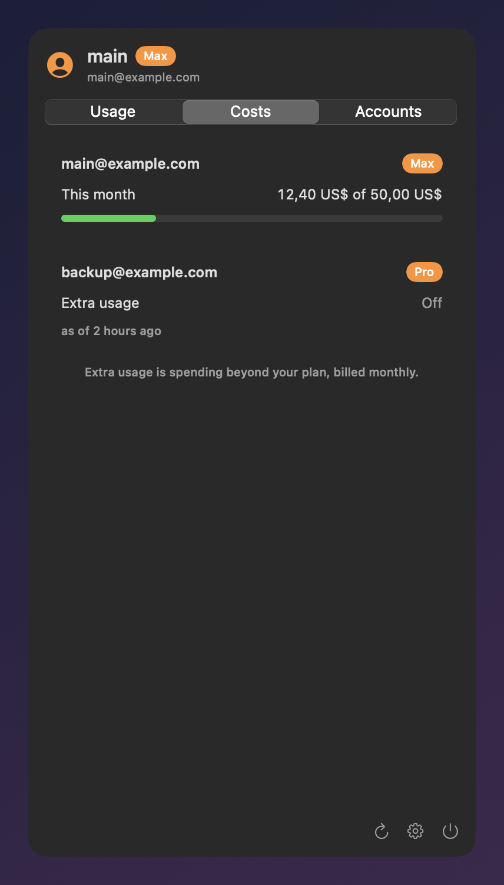
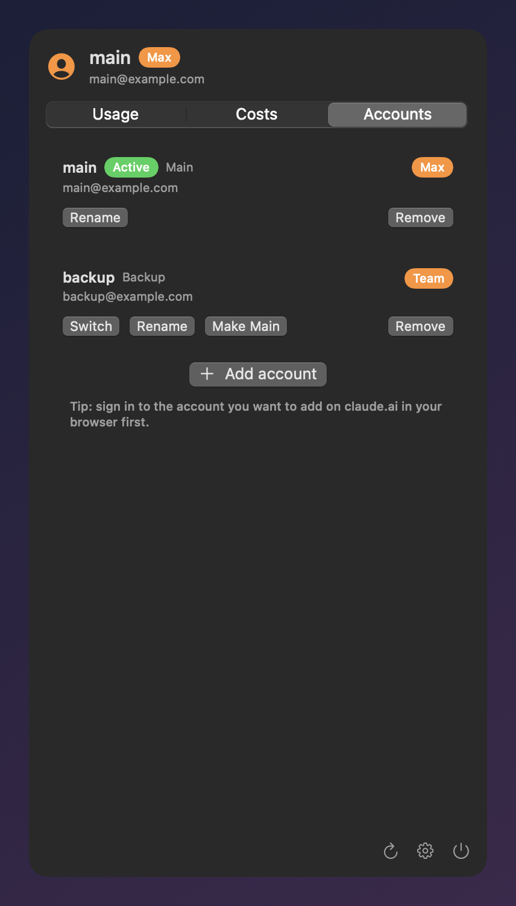
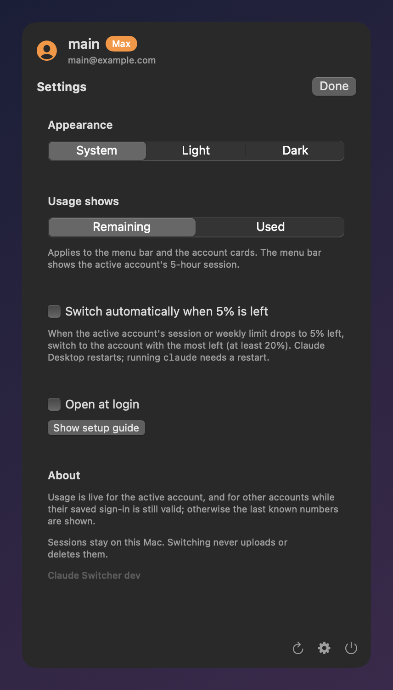

# Claude Switcher

> **Alpha.** It works on the author's Mac; expect rough edges and please report what you find.

**Two Claude accounts, one click.** A small macOS menu-bar app that shows how much usage each of your Claude accounts has left, and switches Claude Code (terminal and VS Code) and the Claude Desktop app to another account when one runs out — without losing any of your sessions.

<p align="center">
  
  
</p>

- See **what's left** on every account: the 5-hour session and the weekly limit, with reset times.
- **Switch** in one click. Your sessions stay on your Mac and keep working under the new account.
- **Add accounts** by signing in on the Claude website — no passwords in the app.
- Shows **extra usage** (spending beyond your plan) per account.
- Optional **auto-switch** when the active account drops to 5% left.

> Screenshots use made-up accounts.

## Install

1. Download `ClaudeSwitcher-<version>.dmg` from [Releases](../../releases), or [build it yourself](#build-it-yourself).
2. Open it and drag **Claude Switcher** onto **Applications**.
3. Open it from Applications. It appears in the menu bar, e.g. `main 70% left`.

The first time, macOS may say the app is from an unidentified developer: right-click the app → **Open** → **Open**.

**Requirements:** macOS 14 or later, and [Claude Code](https://docs.claude.com/en/docs/claude-code/setup) installed (the app uses its sign-in).

## First-time setup

Open the panel — a **Get set up** checklist shows what's left and ticks itself off:

<p align="center"></p>

1. **Install Claude Code** if you haven't.
2. **Add your main account** — click **Add account** and sign in on the Claude website.
3. **Add your backup account** — first switch claude.ai in your browser to the other account (or use a private window), then **Add account** again. You stay on your main account.
4. **Claude Desktop** — sign in to Desktop once as each account (log out and back in as the other one when you're on it). The app remembers Desktop's login from then on.
5. **VS Code** — nothing to do. It uses Claude Code's login; reload the VS Code window after a switch.

## Everyday use

| | |
|---|---|
| **Usage** — each account's session and weekly limits. Click **Switch** on the account you want. |  |
| **Costs** — extra usage this month against your limit. |  |
| **Accounts** — add, rename, choose your main account, remove. |  |
| **Settings** (⚙) — light/dark, show remaining or used, auto-switch, open at login. |  |

**After switching:** restart any `claude` running in a terminal (it keeps the old account until restarted) and reload VS Code's window. Claude Desktop is closed and reopened for you.

**Auto-switch** (off by default, in Settings): when the active account's session or weekly limit drops to 5% left, the app switches to the account with the most left (at least 20%), at most once every 30 minutes, and sends a notification. It closes and reopens Claude Desktop like any switch.

## Good to know

- **Your sessions are never lost.** Terminal and VS Code sessions are files on your Mac that work under any account (`claude --resume`). Claude Desktop's session list is kept in sync between accounts on every switch. Nothing is uploaded.
- **Regular Claude chats** (claude.ai conversations) belong to each account and can't move between them.
- **One account at a time.** Switching quits Claude Desktop, which interrupts anything running in it.
- **Usage numbers** come from the same place Claude Code's `/usage` does. The active account is live; others are live while their saved sign-in is valid (a few hours after you last used them), otherwise the last known numbers are shown with "as of …".

## Troubleshooting

| Problem | Fix |
|---|---|
| **Add account** signs in the same account again | The browser signs in whoever is logged in to claude.ai. Switch accounts there first, or use a private window. |
| "The browser sign-in didn't finish" | Click **Use Terminal instead** and finish the sign-in there. |
| Claude Desktop is still on the old account | It hasn't been signed in as this account yet — sign in once, and the next switches follow. |
| Claude Desktop asks you to sign in after a switch | Please open an issue: the set of files that hold Desktop's sign-in may have changed. |
| A warning line at the top of the panel | It says what failed; most clear up by themselves. Otherwise remove the account and add it again. |

## Privacy and security

- The app never sees your password: adding an account runs Claude Code's own sign-in (`claude auth login`) in your browser.
- Saved sign-ins live in your macOS **Keychain** (`ClaudeSwitcher.<account id>`). Saved Claude Desktop sign-ins are in `~/Library/Application Support/ClaudeSwitcher/vault/`, readable only by you.
- The only network requests are to Anthropic, to read each account's usage.
- Before changing `~/.claude.json` the app keeps a copy at `~/.claude.json.switcher-bak`.

## Build it yourself

Needs Xcode or just the Command Line Tools (`xcode-select --install`).

```bash
git clone <this repo> && cd claude-switcher
scripts/test.sh     # run the tests
scripts/dmg.sh      # builds dist/ClaudeSwitcher-<version>.dmg
```

`scripts/bundle.sh` builds only the `.app`. The version is in `Resources/Info.plist`. Regenerate the screenshots with:

```bash
"$(swift build --show-bin-path)/ClaudeSwitcher" --screenshots docs/images
```

Regenerate the app icon and DMG background with `scripts/make-assets.sh`.

### Releasing

Push a version tag and GitHub builds the DMG and publishes the release (`.github/workflows/release.yml`); versions below 1.0 are marked pre-release.

```bash
git tag v0.1.0 && git push origin v0.1.0
```

How it works, in detail: [docs/HOW-IT-WORKS.md](docs/HOW-IT-WORKS.md). Design notes and plans: [docs/design](docs/design).

## Not affiliated

Claude Switcher is an independent tool. It is not made by or affiliated with Anthropic.
